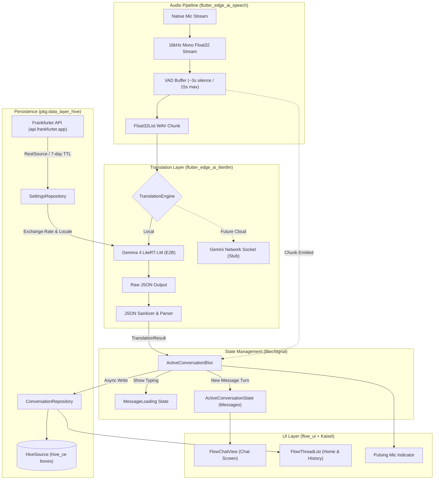

# Real-Time Offline-First Translation App: Implementation Plan (Updated)

This document specifies the technical architecture and implementation roadmap for the offline-first real-time translation app using Gemma 4 on `flutter_edge_ai_litertlm`, native audio capture via `flutter_edge_ai_speech`, `BlocSignal`, `pkg:data_layer` with `pkg:data_layer_hive`, `Kaisel` routing, and `flow_ui`.

---

## 1. System Architecture & Data Flow

The application follows an asynchronous, unidirectional pipeline:
1. **Audio & Edge AI Pipeline (`flutter_edge_ai_speech` + `flutter_edge_ai_litertlm`):**
   * Continuous microphone capture using `flutter_edge_ai_speech` native audio stream.
   * Format: 16kHz mono 32-bit floating point PCM (`Float32List`).
   * Voice Activity Detection (VAD) buffer: flushes on ~3.0s silence detection or upon hitting a 15.0s hard ceiling.
   * Multimodal inference: Gemma 4 (E2B) LiteRT model processes audio tokens directly with structured JSON prompt instructions.
2. **Domain & Repositories (`pkg:data_layer` + `pkg:data_layer_hive`):**
   * Caching exchange rates via `RestSource` (Frankfurter API) and `HiveSource` with a 7-day TTL.
   * Storing conversation metadata and messages in local Hive boxes via `HiveSource`.
3. **State Management (`BlocSignal`):**
   * `ActiveConversationBloc` orchestrates listening states, audio chunk events, optimistic typing indicators (`MessageLoading`), and translated turns.
   * `SettingsBloc` tracks base/target language, currency pairings, and triggers UI updates.
4. **Presentation (`flow_ui` + `Kaisel`):**
   * Declarative chat interface (`FlowChatView`), conversation history (`FlowThreadList`), and a 1-click animated listening button.



---

## 2. Target Directory & Package Structure

```
lib/
├── core/
│   ├── ai/
│   │   ├── translation_engine.dart          # Abstract engine contract & TranslationResult
│   │   ├── local_translation_engine.dart    # Gemma 4 LiteRT-LM implementation
│   │   ├── network_translation_engine.dart  # Network stub (v1 Gemini Socket)
│   │   ├── prompt_templates.dart            # Gemma 4 system prompt & JSON schema
│   │   └── model_manager.dart               # Gemma 4 E2B download & initialization
│   ├── audio/
│   │   ├── native_audio_service.dart        # flutter_edge_ai_speech mic capture stream
│   │   ├── vad_buffer.dart                  # Voice activity detector (~3s silence / 15s max)
│   │   └── audio_exceptions.dart
│   ├── auth/                                # Preserved starter auth (bypassed via NoAuthPolicy)
│   ├── data/
│   │   ├── models/
│   │   │   ├── conversation.dart            # Conversation entity + Hive adapter
│   │   │   ├── message.dart                 # Message entity + Hive adapter
│   │   │   ├── app_settings.dart            # Settings entity + Hive adapter + curated lists
│   │   │   └── exchange_rate_cache.dart     # Exchange rate entity + Hive adapter
│   │   ├── repositories/
│   │   │   ├── conversation_repository.dart # CRUD operations for sessions & messages
│   │   │   └── settings_repository.dart     # Settings & Frankfurter 7-day TTL cache
│   │   └── sources/
│   │       ├── frankfurter_api_source.dart  # RestSource for api.frankfurter.app
│   │       └── hive_sources.dart            # HiveSource configurations & box setup
│   ├── routing/
│   │   ├── routes.dart                      # LoginRoute, HomeRoute, ChatRoute, HistoryRoute, SettingsRoute
│   │   ├── router.dart                      # Kaisel router configuration
│   │   └── redirection.dart                 # Preserved auth guard redirection
│   ├── theme/
│   │   ├── app_theme.dart                   # FlowTheme dark/light configuration
│   │   └── tokens.dart                      # Design tokens
│   ├── serverpod_service.dart               # Preserved Serverpod placeholder service
│   └── dependency_injection.dart            # Injectable registrations (defaults to NoAuthPolicy)
├── features/
│   ├── conversation/
│   │   ├── bloc/
│   │   │   ├── active_conversation_bloc.dart
│   │   │   └── active_conversation_state.dart
│   │   └── widgets/
│   │       ├── pulsing_mic_indicator.dart
│   │       └── active_chat_view.dart
│   ├── history/
│   │   └── history_screen.dart
│   ├── home/
│   │   ├── home_screen.dart                 # Shazam-style ripple button + recent threads
│   │   └── widgets/
│   │       └── ripple_start_button.dart
│   └── settings/
│       ├── bloc/
│       │   ├── settings_bloc.dart
│       │   └── settings_state.dart
│       └── settings_screen.dart
├── screens/
│   └── login/                               # Preserved starter login screen
└── main.dart
```

---

## 3. Dependencies & Permissions

### `pubspec.yaml` Specification
```yaml
dependencies:
  # State & DI
  bloc_signals: ^1.0.1
  bloc_signals_flutter: ^1.2.0
  data_layer: ^0.0.8
  data_layer_hive: ^0.0.2-rc.1
  hive_ce: ^2.1.0
  kaisel: ^1.1.0
  injectable: ^3.0.0
  get_it: ^9.2.1

  # On-Device Edge AI & Native Speech Capture
  flutter_edge_ai: ^2.4.0
  flutter_edge_ai_litertlm: ^2.4.0
  flutter_edge_ai_speech: ^2.4.0

  # UI & Design System
  flow_ui: ^0.3.0
  google_fonts: ^8.1.0
  http: ^1.3.0
  
  # Entity Annotations
  freezed_annotation: ^3.1.0
  json_annotation: ^4.12.0

dev_dependencies:
  build_runner: ^2.16.0
  freezed: ^4.0.0
  injectable_generator: ^3.1.3
  json_serializable: ^6.14.1
  hive_ce_generator: ^2.0.0
```

### Platform Permissions
* **macOS / iOS:** Microphone permission string in `Info.plist` (`NSMicrophoneUsageDescription`) and entitlements (`com.apple.security.device.audio-input`).
* **Android:** `android.permission.RECORD_AUDIO`, `android.permission.INTERNET`.

---

## 4. Phase-by-Phase Implementation Roadmap

### Phase 1: Core Data & State Foundation

#### Step 1: Project Skeleton & Routing (`Kaisel` + `BlocSignal`)
* Preserve existing `lib/core/auth/`, `lib/screens/login/`, and [`ServerpodService`](file:///Users/craiglabenz/Dev/git/craiglabenz/translation_app/lib/core/serverpod_service.dart#L7-L12) starter code, and default [`configureDependencies`](file:///Users/craiglabenz/Dev/git/craiglabenz/translation_app/lib/core/dependency_injection.dart#L14-L19) to `const AuthPolicy.none()` (`NoAuthPolicy`) so the app bypasses login and launches directly into `HomeRoute`.
* Update [routes.dart](file:///Users/craiglabenz/Dev/git/craiglabenz/translation_app/lib/core/routing/routes.dart) with:
  * `LoginRoute`: Preserved starter route.
  * `HomeRoute` (`/home`): Default entry point.
  * `ChatRoute({String? conversationId, bool autoStartListening = true})` (`/chat`): Active listening session or read-only view of an existing conversation with the option to resume listening.
  * `HistoryRoute` (`/history`): Archive of all past conversations.
  * `SettingsRoute` (`/settings`): Language pairs, currency settings, and model management.
* Update [router.dart](file:///Users/craiglabenz/Dev/git/craiglabenz/translation_app/lib/core/routing/router.dart) to build screens corresponding to each route.
* Set up root-level `BlocProvider` and dependency injection in [dependency_injection.dart](file:///Users/craiglabenz/Dev/git/craiglabenz/translation_app/lib/core/dependency_injection.dart).

#### Step 2: Preferences & Frankfurter Currency Caching (`pkg:data_layer_hive`)
* Configure `AppSettings` entity (`baseLanguage`, `targetLanguage`, `baseCurrency`, `targetCurrency`, and optional `modelDownloadUrl` fallback), defaulting to `English (en) / USD ⇄ Spanish (es) / EUR`.
* Provide curated lists of major languages and currencies that can be selected independently in Settings.
* Set up `SettingsRepository` with `SourceList`:
  * `HiveSource` for persistent local storage of settings and cached rates.
  * `RestSource` targeted at Frankfurter (`https://api.frankfurter.app/latest?from={base}&to={target}`).
* Implement 7-day TTL caching logic:
  * If the cached rate is less than 7 days old, return immediately.
  * If older or unavailable, fetch from Frankfurter API and update the Hive cache.
  * If offline and cache expired, fall back to the last known rate with a staleness warning flag.
  * Eagerly initialize and hydrate current exchange rates on app startup.

#### Step 3: Conversation Persistence (`pkg:data_layer_hive`)
* Define entities and adapters:
  * `Conversation`: `id`, `createdAt`, `baseLanguage`, `targetLanguage`, `previewText`.
  * `Message`: `id`, `conversationId`, `timestamp`, `isBaseLanguage`, `originalText`, `translatedText`.
* Set up `HiveSource` boxes (`conversations_box`, `messages_box`).
* Implement `ConversationRepository`:
  * `getRecentConversations({int limit = 3})`
  * `getAllConversations()`
  * `createConversation(...)`
  * `saveMessage(Message message)`
  * `getMessagesForConversation(String conversationId)`
  * `deleteConversation(String conversationId)`

---

### Phase 2: AI & Audio Pipeline

#### Step 4: Engine Abstraction & Network Stub
* Define interface `TranslationEngine`:
```dart
abstract class TranslationEngine {
  Future<void> initialize();
  Future<TranslationResult> translateAudioChunk({
    required Float32List audioWavChunk,
    required String baseLanguage,
    required String targetLanguage,
    required double exchangeRate,
    required String baseCurrency,
    required String targetCurrency,
  });
  Future<void> dispose();
}

class TranslationResult {
  const TranslationResult({
    required this.sourceLanguage,
    required this.translatedText,
    this.originalText,
  });
  final String sourceLanguage;
  final String translatedText;
  final String? originalText;
}
```
* Implement `NetworkTranslationEngine` stub throwing `UnimplementedError('TODO: v1 Gemini Socket')`.

#### Step 5: Edge AI Initialization & Model Management
* Register engine in `main.dart` or during bootstrap:
  ```dart
  await FlutterEdgeAi.initialize(
    inferenceEngines: const [LiteRtLmEngine()],
  );
  ```
* Implement `ModelManager`:
  * Manage Gemma 4 E2B `.litertlm` model weights (optimized for low latency and compact audio encoder) using `flutter_edge_ai`'s built-in model registry/downloader when available, with support for a configurable fallback URL in `AppSettings`.
  * Check local documents directory; download model weights if missing, emitting progress updates (`Stream<double>` / state).
  * Expose model readiness and download controls both on `HomeScreen` (prompting/showing progress before starting a session if not yet downloaded) and in `SettingsScreen`.

#### Step 6: On-Device Engine Implementation (`LocalTranslationEngine`)
* Implement `LocalTranslationEngine`:
  * Formulate system prompt:
    ```
    You are a real-time translator. The user's base language is "{baseLanguage}" and the target is "{targetLanguage}".
    Listen to the provided audio. Identify which of these two languages is being spoken. Translate the speech into the other language.
    Formatting Rules:
    1. Convert any spoken times into standard 24-hour and 12-hour format (e.g., '18:00 (6PM)').
    2. Convert any spoken prices into {baseCurrency} using the exchange rate: 1 {targetCurrency} = {exchangeRate} {baseCurrency}. Output format: 'original price (converted price)'.
    3. Return ONLY a valid JSON object matching this schema: {"detected_language": "en", "translated_text": "...", "original_transcript": "..."}.
    ```
  * Send audio chunk (`Float32List`) directly to the multimodal session.
  * Parse and sanitize JSON responses (handling markdown fences ````json ... ````).

#### Step 7: Native Audio Capture & VAD (`flutter_edge_ai_speech`)
* Implement `NativeAudioService` using `flutter_edge_ai_speech`'s native audio loop/capture:
  * Stream 16kHz mono `Float32List` frames.
* Implement `VadBuffer`:
  * Accumulate frames until silence exceeds **3.0 seconds**.
  * **Safety boundary:** Hard ceiling at **15.0 seconds** of continuous audio to trigger immediate translation and reset the buffer.
  * Flush buffer and yield audio chunk to the translation session.

---

### Phase 3: Business Logic (`BlocSignal`)

#### Step 8: Translation Session Bloc (`ActiveConversationBloc`)
* **Events/Actions:**
  * `startNewSession()`
  * `loadConversation(String conversationId, {bool autoStartListening = false})`
  * `startListening([Conversation? conversation])` (starts or resumes listening in the active/loaded thread)
  * `stopListening()`
  * `onAudioChunkReceived(Float32List chunk)`
  * `cancelSession()`
* **State (`ActiveConversationState`):**
  * `conversation`: current session
  * `messages`: list of `Message` models
  * `isListening`: boolean
  * `isLoading`: boolean (shows typing indicator)
  * `error`: nullable string
* **Flow:**
  1. `onAudioChunkReceived` triggers `isLoading = true`.
  2. Audio chunk sent to `TranslationEngine.translateAudioChunk`.
  3. Compare `detected_language == baseLanguage` to determine `isUser`:
     * If true -> `isUser = true` (base language).
     * If false -> `isUser = false` (target language).
  4. Emit new `Message` to state (`isLoading = false`).
  5. Asynchronously persist message in `ConversationRepository` and update `conversation.previewText`.

#### Step 9: Settings & Locale Bloc (`SettingsBloc`)
* Manages `AppSettings` state (independent selection from curated language and currency lists, plus fallback model download URL).
* Triggers exchange rate updates when currency pairs change.
* Coordinates with `ModelManager` to display model status and trigger downloads/resets in Settings.

---

### Phase 4: UI Implementation (`flow_ui`)

#### Step 10: Theming & Typography
* Configure `FlowTheme.light()` and `FlowTheme.dark()` at the `MaterialApp` level.
* Map design tokens to `FlowColors` and `FlowTypography`.

#### Step 11: Home Screen (1-Click Start)
* Centered, prominent Shazam-style pulsing CTA button:
  * Animated ripple effect.
  * Single tap verifies model readiness (prompting and showing download progress on the Home screen if the Gemma 4 E2B weights are not yet on device), then starts `ActiveConversationBloc` and pushes `ChatRoute(autoStartListening: true)`.
* Below CTA:
  * `FlowThreadList` rendering the **3 most recent conversations** from `ConversationRepository`. Tapping a thread pushes `ChatRoute(conversationId: thread.id, autoStartListening: false)`.
  * Active language pill (e.g., `English (USD) ⇄ Spanish (EUR)`).

#### Step 12: Active Chat Interface
* Use `FlowChatView` in body:
  * Map messages to `FlowMessage` widgets displaying **only `translatedText`** in each chat bubble:
    * `isUser: true` -> right/END aligned, primary bubble styling.
    * `isUser: false` -> left/START aligned, assistant bubble styling.
  * Display typing indicator when `isLoading == true`.
* Hide default `FlowComposer` text input.
* In bottom area:
  * When `isListening == true`: display a persistent pulsing microphone indicator with active audio feedback and session stop button.
  * When `isListening == false` (e.g., viewing a past conversation in read-only mode or after pausing): display a prominent microphone CTA button to **resume listening** in the current conversation thread.

#### Step 13: Conversation History Screen (`/history`)
* Dedicated route rendering full `FlowThreadList` of past sessions.
* Tapping any session navigates to `ChatRoute(conversationId: session.id, autoStartListening: false)`, opening the historic messages in read-only mode with the option to resume listening in that thread.

#### Step 14: Hardening & Edge Cases
* Enforce 15-second VAD ceiling.
* Graceful fallback for non-JSON or malformed LLM outputs.
* Hardware safety: catch NPU/GPU OOM or model initialization failures with user-facing recovery messages.
* Offline resilience: fallback to cached Frankfurter rate if network is unavailable.

---

## 5. Verification & Testing Strategy

1. **Unit Tests:**
   * `VadBuffer`: Silence cutoff (~3s) and hard ceiling (15s).
   * `LocalTranslationEngine`: JSON parsing, markdown stripping, schema validation.
   * `ActiveConversationBloc`: Listening lifecycle, message alignment (`isUser`), repository write triggers.
   * `SettingsRepository`: 7-day TTL caching and Frankfurter fallback.
2. **Widget Tests:**
   * `HomeScreen`: Ripple button interaction, recent threads rendering.
   * `FlowChatView`: Message alignment and typing indicator verification.
